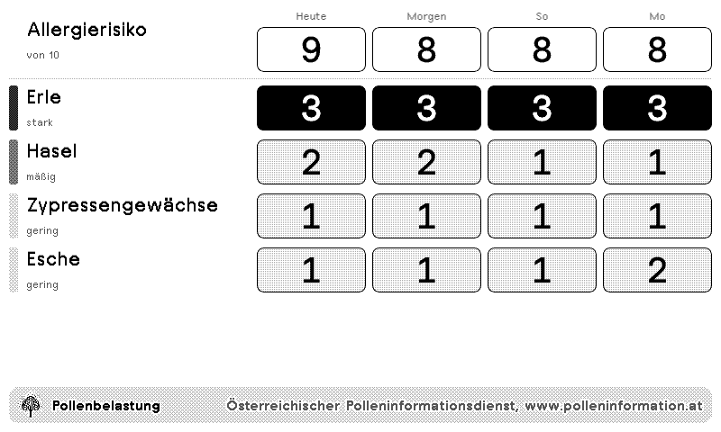

# TRMNL Pollen Information Austria



A TRMNL plug-in that displays current pollen levels for Austria using data from the Österreichischer Polleninformationsdienst. Shows the allergy risk and each pollen type's level for today and the next 3 days, with optional filtering by pollen name.

<a href="https://trmnl.com/recipes/255979">
  
</a>

## Settings

- **API Key** — free key from the Austrian Pollen Information Service (request one via the link in the plugin's About section). Fair use: please don't poll more than once every 4 hours.
- **Country** / **Language** — location and language for pollen names. `Language` also switches the plugin's own UI text between German and English; all other languages fall back to English UI text.
- **Location** — search for a city, address or postal code, or enter coordinates as `latitude,longitude`.
- **Minimum Severity** — hide pollen types below a chosen contamination level (default: hide zero-contamination entries).
- **Pollen Filter** (optional) — comma-separated pollen names to show only those types; partial matches supported.

## Development

Requires a non-system Ruby (macOS ships Ruby 2.6, too old for `trmnlp`):

```sh
export PATH="/opt/homebrew/opt/ruby/bin:$PATH"
trmnlp serve                 # http://localhost:4567
trmnlp lint                  # same gate as CI
trmnlp test --report report  # TRMNL's publishable-recipe checks; open report/index.html
trmnlp build --png
```

Local custom-field presets live in `.trmnlp.yml`. The API key comes from the `POLLEN_API_KEY`
environment variable; set `POLLEN_LATITUDE`/`POLLEN_LONGITUDE` the same way to preview with your
own location without committing it — the checked-in defaults are a public landmark, not a real
address.

`tests/plugin_spec.rb` runs the same checks as TRMNL's recipe review (trmy): every view on
TRMNL OG and TRMNL X in landscape and portrait, dark mode, every select option and a failing API.
It never calls the real API: `tests/fixtures/` holds a quiet autumn answer and a busy spring answer.
`trmnlp test` needs Firefox and geckodriver, or run it in Docker as the CI workflow does. Before
resubmitting the recipe, use "Ask trmy" in the TRMNL publish dialog for a second opinion.

## Credits
Data provided by Österreichischer Polleninformationsdienst, <a href="https://www.polleninformation.at" target="_blank">www.polleninformation.at</a>
